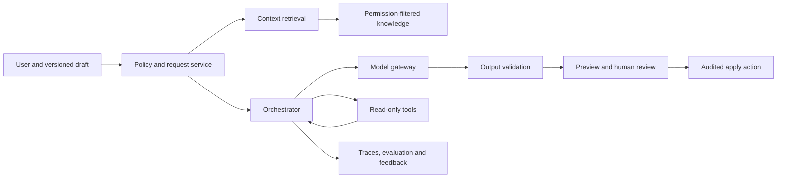

# Applied AI interview preparation for senior software engineers

[Repository index](../README.md) · [Senior system-design workbook](MAANG-Senior-System-Design.md) · [Google Android Studio preparation](../google/android-studio-tech-lead/README.md)

This workbook prepares you for **applied-AI engineering interviews**: building reliable user-facing systems around models, retrieval, tools and data. It is not a machine-learning research or model-training curriculum.

Current engineering roles commonly call for retrieval and knowledge systems, prompt/version management, evaluation, guardrails, monitoring, agent orchestration and production operations. Recent Amazon role descriptions, for example, explicitly mention RAG ingestion at scale, evaluation frameworks, observability, model integration and agent execution. [Quick RAG SDE role](https://www.amazon.jobs/en-gb/jobs/10557546/software-development-engineer-amazon-quick-suite) · [AI/ML Engineer role](https://amazon.jobs/en-gb/jobs/10513234/ai-ml-engineer-amazon-global-data-center-ops-central-insight-and-analytics-team) · [Specialist AI Tooling role](https://www.amazon.jobs/en/jobs/10547170/software-development-engineer-specialist-ai-tooling-specialist-technology-team)

These are signals from individual postings, not a promise that any MAANG interview will ask every topic.

## What your resume already supports

| Resume evidence | AI interview angle | Keep the boundary clear |
| --- | --- | --- |
| CoverSelf: conversational claims-rule authoring, policy Q&A and authoring tools; reported 85% authoring-time reduction | User workflow, structured output, human review, domain correctness, measurement | Confirm feature rollout, model/provider, review path and how the 85% result was measured before presenting details |
| Ushur: AI Data Analyst POC using LangGraph/Mastra, React orchestration UI, custom Superset MCP servers and Yellowbrick MCP integration | Agent orchestration, tool contracts, analytics context, tool-result presentation and failure handling | Call this a POC; the resume does not support claims of model training, large-scale production traffic or a formal model-evaluation program |
| FastAPI + dbt transformation service, data definitions/tests and CI/CD | Document/data ingestion, schema validation, reproducible pipelines and operational ownership | Do not say this alone was an ML training pipeline |
| CoverSelf caching, IndexedDB and browser-side DuckDB-WASM analysis | Data freshness, local performance, offline/cached context and analytical UX | Browser storage is not a security boundary and may not be appropriate for sensitive AI context |
| Luckd payment verification, webhooks, idempotency and reconciliation | Tool side effects, approval boundaries, retries and recovery | Payment experience does not establish an autonomous payment agent; use it to explain safeguards |

Your reliable short answer:

> My AI work is applied product engineering. At CoverSelf, I worked on conversational claims and policy authoring, policy Q&A and related authoring tools. At Ushur, I built an AI Data Analyst POC using LangGraph/Mastra, a React orchestration UI and custom Superset MCP servers for analytics tools. My strongest contribution is designing the workflow around the model—context, tool integration, UI, reliability and user review—rather than training foundation models.

Replace the general wording with the factual details you personally know. Never invent retrieval metrics, model accuracy, latency, traffic or production status.

## The core model: an AI feature is a system

For system-design interviews, start from the user task and treat the model as one fallible dependency. A useful baseline for claims authoring, policy Q&A or analytics assistance is:



The key idea is simple: retrieval chooses what evidence the model sees; tools retrieve or act on live systems; validation constrains machine-readable outputs; and the user approves consequential changes. The model should not receive more data or permission than the task requires.

## Terms you should be able to explain

| Term | Plain explanation | A strong interview detail |
| --- | --- | --- |
| RAG | Retrieve relevant, permitted source material at request time and give it to the model as context | It improves grounding but does not guarantee truth; evaluate retrieval separately from answer quality |
| Embedding | Numeric representation used to find semantically similar text | Chunking, metadata filters and permission filtering often matter as much as vector similarity |
| Reranking | A more precise second pass that orders initial retrieved candidates | Use it when retrieval quality justifies added latency/cost; return citations from the selected source chunks |
| Tool calling / MCP | A model requests a typed application capability; your service validates and executes it | Tool descriptions and tool output are untrusted content, not authority; server-side authorization remains mandatory |
| Agent / orchestration | A loop that selects actions, reads results and decides whether to continue | Bound tool allowlists, steps, time, spend and retries; provide a clear stop/fallback path |
| Structured output | Model output constrained to a schema such as JSON for a rule draft | Validate syntax, schema, business rules and authorization before use; “valid JSON” is not “safe or correct” |
| Evaluation | A repeatable way to measure quality against representative cases | Use task-defined pass criteria, version prompts/models/retrieval, and slice results by risk/domain |
| Guardrail | A control that rejects, transforms or routes unsafe/unreliable behavior | Separate input safety, authorization, output validation and human approval; one classifier is not sufficient |
| Observability | Traces/metrics that let you diagnose AI-system behavior | Record version IDs, latency, token/cost use, retrieval IDs, tool outcomes and safely sampled feedback without logging sensitive raw content by default |

## Senior interview structure for any AI design

Use RESHADED from the system-design guide, with six AI-specific questions at the start:

1. What user task is being improved, and what action remains with the user?
2. Which sources are authoritative, who can access them, and how fresh must they be?
3. Is the desired output prose, a cited answer, a structured draft or a tool side effect?
4. What errors are tolerable, and which could cause financial, clinical, legal, security or workflow harm?
5. What p95 latency, availability and per-request cost budget are acceptable?
6. How will quality be evaluated before and after release, including cases where the system abstains or escalates?

Then state a contract. Example:

> For v1, the assistant answers policy questions using only documents the caller can access, includes sources, and offers a draft rather than applying a rule. Target p95 is under five seconds, with a clear unavailable state if retrieval or the model fails. The system must not disclose another tenant's documents or fabricate a cited policy.

That contract drives the architecture more reliably than starting with a vector database or agent framework.

## Eight high-value practice questions

### 1. Design a policy and claims Q&A assistant

**Prompt:** Employees ask questions over tenant-specific policy documents and claims guidance. Answers must cite approved documents and cannot expose another tenant's information.

**Baseline answer:** Ingest versioned documents; extract text with provenance; chunk at meaningful sections; attach tenant, access-control, document/version and retention metadata. Embed/index approved chunks. At query time authenticate the caller, apply tenant and authorization filters before retrieval, rerank a bounded set, then send the question and evidence to the model. Require citations to retrieved versioned chunks. Render “I could not find support” when evidence is weak rather than inventing an answer.

**Senior follow-ups:**

- A policy changes while a user has a cached answer. How do document versions, freshness targets and citations tell the user what they saw?
- Similar chunks from another tenant score highest. Which filter must run before any retrieval/model context is constructed?
- The model produces a citation that it did not receive. How do output validation and the UI prevent false attribution?
- A scanned PDF extracts badly. How do ingestion quality state, source preview and abstention avoid confident errors?
- Retrieval is relevant but the answer is still wrong. How do you separate retrieval recall from grounded-answer correctness in evaluation?

**Resume connection:** Discuss CoverSelf policy Q&A only to the depth you implemented. If retrieval architecture was not your responsibility, say how you would design it instead of claiming it was already built.

### 2. Design conversational claims-rule authoring

**Prompt:** A user describes a claims rule in natural language. The assistant proposes a structured rule that can affect downstream claims processing, but a human must approve it.

**Baseline answer:** Keep the canonical rule schema and validation service outside the model. Provide the model a narrow schema, permitted field vocabulary and versioned policy context; ask it to create a draft. Validate JSON/schema, references, ranges, conflicts and tenant permissions. Show a human-readable diff and simulation against approved test cases. Persist an immutable draft/version and require an explicit authorized apply action with audit evidence.

**Senior follow-ups:**

- A syntactically valid rule excludes too many claims. What domain validation, simulation and approval controls catch this?
- The user edits the rule while generation runs. How do version checks prevent applying a stale draft?
- The model needs current plan configuration. Should it use an embedded copy, retrieval or a read-only tool, and why?
- How do you learn from user edits without automatically treating every accepted rule as correct ground truth?
- A prompt injection appears inside an uploaded policy document. Why must it not alter system policy or tool permissions?

**Resume connection:** This is your strongest applied-AI story. Prepare the user/problem, your personal ownership, model versus application responsibilities, correction/review flow and the denominator behind the reported 85% authoring-time reduction.

### 3. Design an analytics copilot with read-only tools

**Prompt:** Analysts ask questions about governed enterprise data. The assistant can call Superset-style tools to inspect dashboards, metadata and approved query results, but must not issue writes.

**Baseline answer:** Expose typed, narrow tools such as `listDatasets`, `getMetricDefinition`, `runApprovedQuery` and `getDashboard`. The tool service derives tenant/user authorization server-side and enforces read-only SQL policy, row/column controls, query budgets and result limits. The orchestrator chooses from an allowlist, caps steps/time/cost and shows the retrieved query/result provenance in the UI. Cache only permission-scoped results with bounded freshness.

**Senior follow-ups:**

- A malicious dashboard description tells the model to export secrets. Why is tool output untrusted, and which controls remain outside the model?
- An agent repeats expensive queries. Where do per-request budgets, idempotency keys and query-result reuse belong?
- Data changes during a multi-step analysis. How do snapshot/version semantics show the analysis may be inconsistent?
- A tool call succeeds but the model times out before explaining it. What trace lets the user retry safely without duplicate expensive work?
- How would you add a write-capable action later without making the read-only agent a confused deputy?

**Resume connection:** This directly fits the Ushur AI analyst POC, LangGraph/Mastra orchestration and custom Superset MCP work. Preserve the POC designation unless you can verify production rollout details.

### 4. Design document ingestion and retrieval for enterprise RAG

**Prompt:** Index PDFs, documents, tables and update events from thousands of tenant repositories. Fresh documents should become searchable within fifteen minutes, with deletion and access changes respected.

**Baseline answer:** Use source connectors → durable ingestion queue → malware/content checks → parsers/OCR → normalized versioned document store → chunker/metadata extractor → embedding workers → retrieval index. Make each stage replayable and idempotent by source/version. Propagate document-level ACLs to chunks. Treat deletion/access revocation as high-priority tombstones that remove or suppress documents from retrieval before the freshness deadline; retain operational evidence without serving deleted content.

**Senior follow-ups:**

- An embedding-model upgrade changes the vector space. How do dual indexes, backfill and query routing avoid mixing incompatible embeddings?
- A source connector replays an old version after deletion. What monotonic version/tombstone rule prevents resurrection?
- A 500-page document has tables and poor OCR. How do parsing confidence and chunk quality affect indexing and answer policy?
- The index lags by an hour. What freshness signal reaches callers, and what fallback is safe?
- One tenant adds millions of near-duplicate documents. How do quota, deduplication and noisy-neighbor isolation work?

**Resume connection:** Tie to your FastAPI/dbt service only for actual data-validation and deployment work. Frame the distributed ingestion architecture as an interview design, not a system you necessarily shipped.

### 5. Design an AI coding assistant for an IDE

**Prompt:** Provide code explanation and proposed edits inside an IDE without blocking editing, leaking excluded files or silently changing source code.

**Baseline answer:** Capture a versioned editor request; retrieve only permitted workspace context; apply exclusion/privacy policy before any model call. Stream explanation separately from an edit plan. Bind a patch to document versions; on apply, validate/rebase explicitly, show a diff and require approval. Offer approved build/test tools only through constrained capabilities. Record outcome signals such as compile/test result and user edits, without treating acceptance alone as correctness.

**Senior follow-ups:**

- The user types while generation runs. When can an edit rebase, and when must it regenerate?
- A repository comment contains a tool instruction. How do you prevent it from changing authority?
- Context is too large. How do symbol-aware retrieval, summaries and token budgets affect correctness?
- The proposed edit compiles but changes behavior. What offline evaluations and in-product safety gates detect this?
- What is the first bottleneck at 10× usage: model capacity, context assembly, tool execution or client streaming?

**Resume connection:** Relate your complex authoring/editor UI work to versioned user workflows, while keeping the distinction from IDE internals clear. This is particularly relevant to your Android Studio preparation.

### 6. Build an evaluation and release system for an LLM feature

**Prompt:** A team changes models, prompts, retrieval settings and tools often. Design a release process that detects regressions before broad rollout.

**Baseline answer:** Version every configuration: model, system prompt, tool schema, retrieval/index version, chunking/reranker and application code. Maintain a representative evaluation set with expected evidence/structured output and risk slices. Run deterministic checks where possible: schema validity, citation support, permissions, tool-call policy and known harmful requests. Add human adjudication for subjective quality. Compare a candidate to a baseline, canary it, monitor online signals and retain a rollback path.

**Senior follow-ups:**

- Quality rises overall but worsens for a high-risk policy type. How do slice gates override aggregate scores?
- The provider silently updates a model. Which version evidence and release controls let you detect and contain drift?
- Users accept fast but wrong answers. Why is acceptance rate insufficient, and what outcome measures improve it?
- Ground-truth labels disagree. How do adjudication rules and inter-rater review avoid arbitrary scores?
- An offline win harms p95 latency/cost. How do you decide whether to ship?

**Resume connection:** Do not claim an established evaluation platform unless you built one. Present this as the most valuable next capability for the workflows on your resume.

### 7. Design safety, privacy and audit controls for an AI workflow

**Prompt:** An assistant processes sensitive claims/policy data and may propose operational changes. Design controls that satisfy data minimization, authorization and investigation needs.

**Baseline answer:** Classify data and set retention rules before integration. Authenticate every request and derive authorization at the data/tool boundary. Minimize/redact context, enforce tenant isolation, encrypt data, and use service identities with least privilege. Separate read tools from write tools; require explicit user confirmation for meaningful side effects. Store auditable events with request/config/version/tool identifiers and privacy-preserving references, not indiscriminate raw prompts or sensitive results.

**Senior follow-ups:**

- A user has document access but not permission to apply a rule. How do the retrieval and apply paths differ?
- A tool returns personal data that the model should not repeat. Where can minimization/redaction occur?
- A user asks to delete data. What happens in raw storage, chunk indexes, caches, evaluation data, backups and traces?
- A model-provider outage causes fallback to another provider. How do data-residency and contractual rules constrain that fallback?
- An incident needs prompt evidence, but retention policy forbids raw logging. What metadata and controlled access still permit investigation?

**Resume connection:** Your payment and role-based-access experience provides credible grounding in authorization and audit boundaries. Do not make healthcare compliance claims unless you can name the actual control and responsibility.

### 8. Improve latency and cost in an AI assistant

**Prompt:** A feature has 9-second p95 latency and high per-request cost. Reduce both without creating a major quality regression.

**Baseline answer:** Break latency into request validation, retrieval, reranking, model queue/first token, generation, tool calls and client rendering. Measure each step by request type. Reduce context through better retrieval and deduplication; use caching only for permission-safe, stable work; route simple tasks to a cheaper/faster model; set response-length budgets; parallelize independent retrieval where justified; and cancel abandoned work. Compare against evaluation gates rather than assuming shorter prompts preserve quality.

**Senior follow-ups:**

- Why can semantic caching leak data across tenants, and what cache key/authorization condition is required?
- A smaller model saves cost but fails on complex rules. How do routing confidence and safe fallback work?
- Streaming improves perceived latency but not completion latency. Which metrics distinguish them?
- A retry doubles token cost. Where do deadlines, idempotency and retry budgets live?
- Retrieval dominates latency. When do precomputation, index changes or product scope beat changing the model?

**Resume connection:** Discuss frontend caching and performance work as transferable engineering experience, while clearly separating API-request reduction from AI inference savings.

## Questions interviewers may ask about your resume

Prepare factual answers to these before a call:

| Question | What your answer must include |
| --- | --- |
| What did the model do, and what did your application do? | Clear boundary: context/retrieval, orchestration, schema validation, UI, human review and final state change |
| Why did you use LangGraph/Mastra or MCP? | The concrete orchestration/tool-integration problem; framework choice is secondary to explicit tool contracts and failure behavior |
| How did you prevent hallucinations? | Do not promise prevention. Explain grounding, constrained outputs, validation, citations, abstention and review, plus their limits |
| How did you measure the 85% reduction? | Task, baseline, new time, sample, period, whether corrections/review were included, and whether the number was measured or estimated |
| How did you evaluate quality? | State the real method. If it was informal/user review, say so and describe the evaluation system you would add |
| What happens on a tool/model failure? | User-visible fallback, retry/deadline policy, idempotency if a tool has effects, monitoring and recovery |
| What would you improve next? | Versioned evaluations, source quality/freshness, policy enforcement, observability and controlled rollout—choose only what is true for the system |

## AI answer template

Copy this alongside the system-design template for an AI mock.

```markdown
## AI question:
### User task, users and excluded scope:
### Output contract and harm if wrong:
### Authoritative sources, freshness and permissions:
### Model, retrieval and tool boundaries:
### API/data model and version identities:
### One request trace, including user approval:
### Evaluation set, release gate and rollback:
### Safety/privacy controls:
### Latency and cost budget:
### Failure scenario and recovery:
### Resume connection / claims I can factually defend:
### What I missed:
```

## Two-week AI study plan

Do one 55-minute design or 30-minute deep dive daily. Spend the last ten minutes speaking your answer aloud and recording gaps.

| Day | Practice |
| --- | --- |
| 1 | Read the terms table; prepare your 60-second applied-AI answer |
| 2 | Q1 policy/claims Q&A: tenant filtering and cited answers |
| 3 | Q2 claims-rule authoring: structured draft, simulation and approval |
| 4 | Q3 analytics copilot: tool contracts and prompt injection |
| 5 | Q4 RAG ingestion: deletion and embedding migration |
| 6 | Q6 evaluation/release: construct ten representative test cases |
| 7 | Rehearse CoverSelf and Ushur stories; list unknown facts to verify |
| 8 | Q7 safety/privacy: deletion, audit and authorization paths |
| 9 | Q8 latency/cost: write a trace and pick metrics |
| 10 | Q5 IDE coding assistant: stale edit and context constraints |
| 11 | 55-minute unseen design: combine RAG with one read-only tool |
| 12 | Failure drill: model outage, stale index and unauthorized tool request |
| 13 | Evaluation review: compare candidate configurations against a baseline |
| 14 | Mock interview: one design plus five resume follow-ups; retest your weakest area |

## Readiness check

You are ready to discuss applied AI at a senior-engineer level when you can do all of the following without framework name-dropping:

- Define a user task and a measurable output contract before choosing a model.
- Explain evidence retrieval, authorization and freshness separately.
- Trace a model/tool request including retries, approval and audit boundaries.
- Describe an evaluation that distinguishes retrieval failures, model failures and unsafe tool behavior.
- Name a safe degradation path for missing evidence, model outage and stale client state.
- Tell the CoverSelf and Ushur stories with factual ownership, limits and one improvement you would make.

For a role that primarily values model research, training, fine-tuning or ML theory, this material is only a foundation. State that your background is application and platform engineering, then prepare the required ML depth separately.
